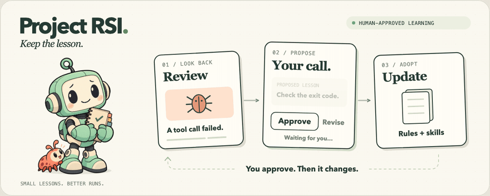

# Project RSI



[English](README.md) · [简体中文](README.zh-CN.md)

**Turn real project mistakes into better project instructions and skills—with human approval before adoption.**

Project RSI is a portable [Agent Skill](SKILL.md) and a small Python toolkit. It helps your coding agent review what went wrong, propose a focused improvement, check it against examples, and show you an interactive HTML review. You decide what to adopt. The toolkit applies only approved changes and returns a readable receipt with the affected files and checks.

**Local execution, no built-in data collection.** The shipped scripts and portable `local` approval service run on your computer. Project RSI does not add a project-data upload destination, telemetry, or a hosted collection service. Model requests and the optional native conversation bridge follow the data handling of the harness and providers you choose. Read the [privacy boundaries](#local-execution-and-data-boundaries) and [disclaimer](#disclaimer).

It works with project instructions such as `AGENTS.md`, `CLAUDE.md`, `GEMINI.md`, Cursor `.mdc` rules, Copilot instructions, or a project-specific filename. It does not train model weights or grant the agent new permissions.

Inspired by Google Research's [Harness²](https://github.com/google-research/harness2) and its propose–probe–compose approach. This is an independent implementation; no Google source code is included.

## What the review looks like

Each proposal explains the mistake, the proposed change, why it should help, and the evidence. Details and the before/after comparison can be expanded when needed.

- **Approve:** adopt the frozen proposal after validation.
- **Reject:** leave that proposal's targets unchanged.
- **Request changes:** write a note; the agent prepares a new proposal for confirmation.
- **Ask for an explanation:** get an answer before deciding.

Notes use a full-width, multiline field. Approval is never preselected. An approval accompanied by a note is held for interpretation, so the note cannot be silently ignored. After processing, the agent must say **which instruction file or skill changed, what changed, and what was verified**.

## Requirements

- Python **3.9 or later**. The scripts use only the Python standard library.
- A coding agent that can read the skill, inspect project evidence, and run local commands.
- A browser for the portable HTML review, or a supported native conversation widget.

No API key is required by this toolkit. Your chosen harness has its own account and model requirements. Installation does not create a scheduled task or start a background service.

The examples below use a POSIX shell. On Windows, use `python` or `py -3` if `python3` is unavailable, supply your own absolute project path, and join commands split with `\` onto one line in PowerShell or Command Prompt. For example, from the downloaded repository:

```powershell
py -3 scripts/project_rsi.py init --project "C:/work/my-project" --harness workbuddy --transport local --install-skill
```

Project-relative paths in configuration and plans use forward slashes on every platform. You can download the repository ZIP from GitHub if you do not use Git.

## Install into a project

Clone the repository, enter it, and initialize the project you want to improve:

```sh
git clone https://github.com/jdbsh-AI/project-rsi.git
cd project-rsi
python3 scripts/project_rsi.py profiles
python3 scripts/project_rsi.py init \
  --project /absolute/path/to/your-project \
  --harness claude \
  --transport local \
  --install-skill
```

Replace the absolute path and harness with your own. Available harness profiles are `codex`, `claude`, `gemini`, `cursor`, `copilot`, `opencode`, `dsh`, and `workbuddy`; `generic` supports custom layouts. `auto` detects an unambiguous project signature; choose a profile explicitly when several harnesses share a project.

`init` creates `.project-rsi/config.json`. With `--install-skill`, it also copies the skill into the selected profile's first skill directory, for example `.claude/skills/project-rsi/`. It **does not edit the project's instruction files**. Start or refresh your harness as its skill discovery requires, then ask it to use Project RSI. In clients that expose skills as slash commands, the command is usually `/project-rsi`; Codex can also invoke `$project-rsi`.

The installation command cannot start every harness or make it load the skill. It reports `schedule_onboarding` status and a `next_step`; when an agent first actually loads this skill in an interactive conversation, the agent checks the private setup state and proactively offers scheduled reviews. You choose whether to enable them and, if so, the frequency, time or interval start, and timezone. No timer or default review time is installed. See [optional scheduled reviews](#optional-scheduled-reviews).

If your project uses different names or directories, declare them explicitly. Paths below are relative to the target project:

```sh
python3 scripts/project_rsi.py init \
  --project /absolute/path/to/your-project \
  --harness generic \
  --instructions TEAM_GUIDE.md \
  --instructions docs/agent-policy.md \
  --skill-root .agents/skills \
  --transport local \
  --install-skill
```

`--instructions` and `--skill-root` can be repeated. They replace the corresponding profile defaults. Instruction targets must be project-local `.md` or `.mdc` files. Declaring a file adds it to the review target allowlist; each proposed change still requires approval. **It does not make your harness load that file.** Configure the harness's discovery/import setting when necessary. See [harness compatibility](references/harnesses.md).

## Try a complete, isolated demo

Run this from the cloned repository. Choose a demo directory that does **not** already exist:

```sh
python3 scripts/project_rsi.py demo \
  --directory /absolute/path/to/new-rsi-demo \
  --harness cursor
python3 scripts/review_server.py \
  --run /absolute/path/to/new-rsi-demo/run \
  --once
```

The demo creates a separate synthetic project and three proposals. It also writes `demo.json`, including the local review session ID. The server prints a `review_url`; open that URL in your browser.

1. Approve one proposal.
2. Reject another.
3. Request changes to the third and enter a multiline note.
4. Submit and inspect the on-page receipt and terminal output.

The local server validates the submission, applies approved demo changes, and shows the receipt. With `--once`, it then exits. Rejected or deferred proposals are recorded without applying their candidates. All writes stay inside the synthetic demo project; this demo does not change the project you initialized earlier.

For an agent-assisted test, ask your agent to run the server and wait for its result. When you submit, the command returns a receipt that the waiting agent can read and explain immediately. If you start the server yourself in an unrelated terminal, it will process the review, but it cannot automatically wake an arbitrary existing IDE chat.

## Use it for real work

Ask your agent:

> Use Project RSI to review yesterday's work in this project. Find mistakes supported by execution evidence, including unsuitable tool or skill use. Propose small instruction or skill changes, test the candidates with permitted examples, and present an HTML review. Do not change active instructions or skills until I approve the specific proposals. After processing my decisions, tell me exactly which files changed and why.

The agent reads [SKILL.md](SKILL.md), collects bounded evidence, prepares a private run, and builds the review. It should check whether an existing instruction already covers the mistake before adding another one. Synthetic checks are labeled as such; they do not prove that future agent behavior has improved.

For a portable local run, the command sequence is:

```sh
python3 scripts/project_rsi.py build \
  --plan /absolute/path/to/private-run/plan.json \
  --output /absolute/path/to/private-run/form.html \
  --session-id review-session-01
python3 scripts/review_server.py \
  --run /absolute/path/to/private-run \
  --once
```

Use the same review session ID in the plan and command. A local session ID correlates a review and its receipt; it is not proof of an IDE conversation's identity. The server handles submission consumption. When integrating a separate authorized receiver, the underlying command is:

```sh
python3 scripts/project_rsi.py consume \
  --run /absolute/path/to/private-run \
  --submission /absolute/path/to/private-run/submission.json \
  --confirmation-reference 'reference to the actual human submission' \
  --session-id review-session-01
```

The engine freezes the plan, candidates, probes, allowed targets, and baseline hashes before approval. It checks them again before adoption, preserves concurrent changes outside the managed lesson section, journals writes, reads back results, and makes identical duplicate submissions idempotent. An existing project-specific application guard still takes precedence; the generic consumer does not bypass it.

See [the run protocol](references/protocol.md) for plan fields and constraints, and [submission and receipt delivery](references/callback.md) for transport and acceptance details. Keep generated runs, logs, and receipts private and outside your public skill source tree.

## Harness compatibility

These are the bundled profile targets, not a claim that every client version has been tested:

| Profile | Default instruction target | First skill installation directory | Default review transport |
|---|---|---|---|
| `codex` | `AGENTS.md` | `.agents/skills/project-rsi` | Native widget |
| `claude` | `CLAUDE.md` | `.claude/skills/project-rsi` | Local HTML server |
| `gemini` | `GEMINI.md` | `.gemini/skills/project-rsi` | Local HTML server |
| `cursor` | `.cursor/rules/project-rsi.mdc` | `.cursor/skills/project-rsi` | Local HTML server |
| `copilot` | `.github/copilot-instructions.md` | `.github/skills/project-rsi` | Local HTML server |
| `opencode` | `AGENTS.md` | `.opencode/skills/project-rsi` | Local HTML server |
| `dsh` | `AGENTS.md` | `.dsh/skills/project-rsi` | Local HTML server |
| `workbuddy` | `CODEBUDDY.md` | `.codebuddy/skills/project-rsi` | Local HTML server |
| `generic` | `AGENTS.md` | `.agents/skills/project-rsi` | Local HTML server |

Use `--instructions` to target an actual loaded override or custom entry, and `--transport local` for Codex clients without the native widget API. Cursor rule frontmatter is preserved; a newly created `.mdc` rule uses the required rule format. Official references, loading differences, and custom filename examples are in [references/harnesses.md](references/harnesses.md).

DSH initialization uses an existing `CLAUDE.md` when `AGENTS.md` is absent. WorkBuddy initialization reuses an existing `.codebuddy/CODEBUDDY.md`, then `AGENTS.md`, when root `CODEBUDDY.md` is absent. WorkBuddy's code-project skill directory is **`.codebuddy/skills`**, not an invented `.workbuddy/skills` directory. These are local code-project profiles; they do not synchronize cloud project assets or private user skill libraries.

**Compatibility has several separate parts.** Profile/path tests check generated files and guarded adoption. They do not prove a harness has loaded the skill or followed the lesson. A real native end-to-end test additionally requires an actual HTML click, delivery into the intended conversation, processing, read-back, and a result returned to the user.

The native transport requires the conversation host's `window.openai.sendFollowUpMessage` API and checks for it at runtime. An ordinary browser tab does not have that API. The local transport works through an explicit server command and returns its result to the waiting process; it does not inject messages into arbitrary running chats. Claude Channels, OpenCode's session API, and Cursor's SDK are possible host-specific integration points, but this release does not implement those bridges. Unsupported delivery must be reported clearly, without a success claim or an undocumented socket/second CLI writer workaround.

## Optional scheduled reviews

On the first actual interactive use, the agent checks the project's saved setup state and current conversation before asking:

> Would you like scheduled project reviews? Set up / No thanks / Later.

If you choose to enable them, you decide the frequency—daily, weekdays, weekly, or a custom cadence—plus the execution time or interval start and timezone. The agent asks only for missing details. If you have already supplied a complete preference, it proceeds without repeating the questions. There is no default time or timezone.

Declining or choosing later is remembered in the private `.project-rsi/schedule-setup.json` file, so subsequent skill uses do not repeatedly ask. You can reopen setup by explicitly asking to set up or change scheduled reviews. A scheduled background run never starts this first-use conversation.

Before creating anything, the agent checks the current host's scheduling capability and reads any existing schedule for this project. It reuses a matching schedule and reads back the result to avoid duplicates. The state helper records your preferences and host receipts; it does not create jobs, and its saved record does not prove that a host schedule is still active. The eight harness profiles describe file integration, not universal native scheduling support. If the current host has no supported scheduler, the agent explains that and continues with manual reviews; it does not install `cron` or `launchd`, choose a time for you, or claim scheduling succeeded.

Installation and agreement to a timer do not authorize automatic changes to project instructions or skills. Scheduled reviews collect bounded evidence, prepare proposals and an HTML review, and wait for approval of the specific changes. Submitted decisions are processed when their supported transport delivers them, independently of the review cadence. Preserve your notification preference; without a request for routine updates, stay quiet when there is no new actionable finding. See [the scheduling guide](references/scheduling.md) for the agent workflow and private state commands.

## Local execution and data boundaries

**Project RSI's Python helpers and portable local approval service run locally.** This toolkit has no built-in analytics, telemetry, crash reporting, hosted backend, or automatic upload of project content to its maintainers or another third-party collection service. It does not call a model API or ask for a model-provider API key itself.

- **Local review mode:** the browser posts decisions to a token-bound `127.0.0.1` service. Evidence, candidates, plans, diffs, backups, submissions, and receipts remain in the local directories you select. The shipped page loads no third-party scripts, fonts, or tracking resources.
- **Model processing:** your chosen harness may send the project context it selects to the model provider you configured. That processing is governed by your harness/provider settings, retention policy, and account terms. Project RSI adds no separate destination for that information.
- **Native conversation mode:** the form uses the selected conversation host's API for follow-up messages and optional draft state. This can disclose review content, decisions, notes, and local run references to that host and its configured services. It is subject to the host's privacy policy; it is not a local-only transport. Use `--transport local` when review submission and storage must stay on your machine.
- **Other software and publication:** harness telemetry, plugins, connectors, browser extensions, cloud-synced folders, remote workspaces, and user-authorized publishing are outside this toolkit's control. Installing/updating from GitHub downloads public source; the repository's CI runs public source and synthetic fixtures on GitHub runners. Neither is an automatic upload of your private project runs.

The privacy commitment above describes **Project RSI's own shipped behavior**. It is not an unconditional claim that every harness/provider/plugin combination discloses data only to a model company. Review the settings of the environment you choose, send only necessary and appropriately redacted context to models, and keep private run directories out of public repositories and shared/synced folders.

## Disclaimer

This project is provided **AS IS**, under the [MIT License](LICENSE), without warranties of accuracy, fitness for a particular purpose, error prevention, security, confidentiality, or improvement in future agent behavior. It is an independent project and is not endorsed by Google Research or the supported harness vendors.

Agents and models can make mistakes, and approved changes can affect later project behavior. Review proposals and diffs, keep suitable backups, and verify results before relying on them. You are responsible for having permission to process the project data and for choosing the harness, model service, plugins, and storage settings appropriate to it. The maintainers do not control those services or their data handling. Warranty and liability limitations apply as stated in the MIT License and to the extent permitted by applicable law.

## Validate and contribute

```sh
python3 -m unittest discover -s scripts -p 'test_*.py'
```

Run the isolated browser demo as well when changing form submission or local delivery. A passing unit suite is not a substitute for testing a real host's native delivery. Contributions should include focused regression checks and state which layer was tested. Please use synthetic examples and avoid publishing private project evidence, credentials, customer files, or real conversation IDs.

## License

[MIT](LICENSE). See [SKILL.md](SKILL.md) for the workflow, [the protocol](references/protocol.md) for guarded adoption, and [the callback contract](references/callback.md) for delivery guarantees and limits.
